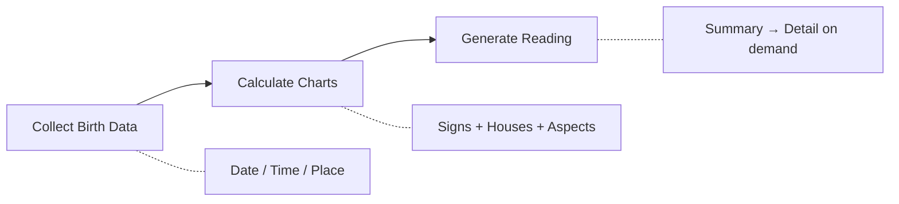

# Aistro Skills

<p align="center">
  
  
  
  <a href="https://github.com/ArcBlock/aistro-skills/blob/main/LICENSE.md">
    
  </a>
  <a href="https://github.com/ArcBlock/aistro-skills/stargazers">
    
  </a>
</p>

<p align="center">
  English | <a href="./README.zh.md">中文</a>
</p>

An AI skill that provides professional astrology consultations with personalized readings and detailed reports.

## What is Aistro?

Aistro is an AI-powered astrology consultation skill that combines traditional astrological knowledge with modern AI capabilities. It delivers personalized birth chart analyses, daily horoscopes, compatibility reports, and lunar influence readings — all through natural conversation with your AI coding agent.

**Key highlights:**
- Professional-grade astrology readings
- Five consultation modes for different needs
- Multi-language support (auto-detects user language)
- Two-layer report system: quick summary + detailed analysis on demand

## How it Works



## Features

| Feature | Description |
|---------|-------------|
| **Chat Mode** | Conversational astrology Q&A with a professional astrologer persona |
| **Natal Report** | Birth chart analysis across 10 planets with strengths, opportunities, and challenges |
| **Predict Report** | Daily horoscope covering career, love, wealth, creativity, and health |
| **Synastry Report** | Compatibility analysis between two people across 7 planets |
| **Moon Phase Report** | Lunar influence reading based on current moon phase and natal chart |
| **Two-Layer Reports** | Quick overview first, expand any section for detailed analysis |
| **Multi-Language** | Auto-detects and responds in the user's language |

## Installation

```bash
npx skills add ArcBlock/aistro-skills
```

> Powered by [skills](https://github.com/vercel-labs/skills) — supports Claude Code, Cursor, Codex, Gemini CLI, and [35+ more agents](https://github.com/vercel-labs/skills#supported-agents).

Or simply tell your AI coding agent:

> Please install Skills from github.com/ArcBlock/aistro-skills

<details>
<summary><b>Via Claude Code Plugin Marketplace</b></summary>

```bash
# Register marketplace
/plugin marketplace add ArcBlock/aistro-skills

# Install plugin
/plugin install aistro@aistro-skills
```

</details>

## Quick Start

Just tell your AI assistant what you want in natural language:

```
/aistro I was born on March 15, 1990 at 2:30 PM in Beijing. What does my birth chart say?
```

```
/aistro What's my horoscope for today?
```

```
/aistro Check compatibility between me and my partner born on July 22, 1988
```

```
/aistro What does the current moon phase mean for me?
```

That's it! The skill collects your birth information and generates personalized readings automatically.

## Report Types

### Natal Report
Analyzes 10 planets (Sun, Moon, Mercury, Venus, Mars, Jupiter, Saturn, Uranus, Neptune, Pluto) in your birth chart. Each planet includes a title, strengths, opportunities, and challenges.

### Predict Report
Daily horoscope comparing your natal chart with current planetary transits. Covers 5 topics: Career, Love, Wealth, Creativity, and Health — each with a score (40-100) and detailed analysis.

### Synastry Report
Compatibility analysis examining 7 planets (Sun, Moon, Mercury, Venus, Mars, Jupiter, Saturn) between two birth charts. Provides an overall score and per-planet breakdown of similarities and differences.

### Moon Phase Report
Reading based on the current moon phase combined with your natal chart. Includes retrograde planet influences and practical guidance for career, love, and wealth.

## FAQ

<details>
<summary><b>What information do I need to provide?</b></summary>

For the most accurate readings, provide your:
- **Birth date** (required)
- **Birth time** (recommended for precise house placements)
- **Birth place** (recommended for accurate rising sign)

If you don't know your exact birth time, the skill can still provide readings based on available information.

</details>

<details>
<summary><b>How accurate are the readings?</b></summary>

Aistro uses Claude's extensive knowledge of astrological traditions including Western astrology, evolutionary astrology, and aspect interpretation. The readings follow the styles of respected astrologers like Steven Forrest and Sue Tompkins.

</details>

<details>
<summary><b>Can I get a detailed breakdown of a specific planet or topic?</b></summary>

Yes! Reports use a two-layer system. You first receive a summary overview, then you can ask to expand any specific planet or topic for a detailed analysis. You can also request the full detailed report at once.

</details>

<details>
<summary><b>What languages are supported?</b></summary>

Aistro auto-detects the language you use and responds in the same language. It works well in English, Chinese, and other major languages.

</details>

## Contributing

Contributions are welcome! Please open an [issue](https://github.com/ArcBlock/aistro-skills/issues) or submit a pull request.

## Related Projects

- [Aistro iOS App](https://apps.apple.com/app/aistro) - AI-powered astrology app for iOS
- [MyVibe](https://www.myvibe.so) - AI-powered web project hosting platform

## Support

- **Issues**: [GitHub Issues](https://github.com/ArcBlock/aistro-skills/issues)

## Author

[ArcBlock](https://www.arcblock.io) - Building decentralized identity and Web3 infrastructure.

GitHub: [@ArcBlock](https://github.com/ArcBlock)

## License

[Elastic License 2.0](./LICENSE.md)
