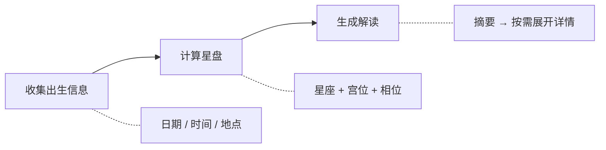

# Aistro Skills

<p align="center">
  
  
  
  <a href="https://github.com/ArcBlock/aistro-skills/blob/main/LICENSE.md">
    
  </a>
  <a href="https://github.com/ArcBlock/aistro-skills/stargazers">
    
  </a>
</p>

<p align="center">
  <a href="./README.md">English</a> | 中文
</p>

一个提供专业占星咨询的 AI 技能，支持个性化星盘解读和详细报告生成。

## 什么是 Aistro？

Aistro 是一个 AI 驱动的占星咨询技能，将传统占星学知识与现代 AI 能力相结合。通过与 AI 编程助手的自然对话，为你提供个性化的本命盘分析、每日运势、合盘配对和月相解读。

**核心亮点：**
- 专业级占星解读
- 五种咨询模式满足不同需求
- 多语言支持（自动检测用户语言）
- 双层报告系统：快速摘要 + 按需展开详细分析

## 工作原理



## 功能特性

| 功能 | 描述 |
|------|------|
| **聊天模式** | 以专业占星师身份进行对话式占星问答 |
| **本命盘报告** | 10 颗行星的出生星盘分析，包含优势、机遇和挑战 |
| **运势报告** | 每日运势，涵盖事业、感情、财富、创造力和健康 |
| **合盘报告** | 7 颗行星的双人配对兼容性分析 |
| **月相报告** | 基于当前月相和本命盘的月亮影响解读 |
| **双层报告** | 先展示快速概览，可展开任意部分查看详细分析 |
| **多语言** | 自动检测并使用用户的语言回复 |

## 安装

```bash
npx skills add ArcBlock/aistro-skills
```

> 基于 [skills](https://github.com/vercel-labs/skills) — 支持 Claude Code、Cursor、Codex、Gemini CLI 及 [35+ 更多 Agent](https://github.com/vercel-labs/skills#supported-agents)。

或者直接告诉你的 AI 编程助手：

> 请从 github.com/ArcBlock/aistro-skills 安装 Skills

<details>
<summary><b>通过 Claude Code 插件市场安装</b></summary>

```bash
# 注册市场
/plugin marketplace add ArcBlock/aistro-skills

# 安装插件
/plugin install aistro@aistro-skills
```

</details>

## 快速开始

用自然语言告诉你的 AI 助手你需要什么：

```
/aistro 我 1990 年 3 月 15 日下午 2:30 在北京出生，帮我看看本命盘
```

```
/aistro 今天的运势怎么样？
```

```
/aistro 帮我看看我和 1988 年 7 月 22 日出生的伴侣的配对
```

```
/aistro 当前月相对我有什么影响？
```

就这么简单！技能会自动收集你的出生信息并生成个性化解读。

## 报告类型

### 本命盘报告
分析出生星盘中的 10 颗行星（太阳、月亮、水星、金星、火星、木星、土星、天王星、海王星、冥王星），每颗行星包含标题、优势、机遇和挑战。

### 运势报告
将本命盘与当前行星过境进行对比的每日运势。涵盖 5 个主题：事业、感情、财富、创造力和健康——每个主题都有评分（40-100）和详细分析。

### 合盘报告
检查两个人出生星盘中 7 颗行星（太阳、月亮、水星、金星、火星、木星、土星）的兼容性分析。提供总分和每颗行星的相似点与差异点。

### 月相报告
基于当前月相结合本命盘的解读。包含逆行行星的影响以及事业、感情和财富方面的实用指导。

## 常见问题

<details>
<summary><b>需要提供哪些信息？</b></summary>

为获得最准确的解读，请提供：
- **出生日期**（必需）
- **出生时间**（建议，用于精确宫位）
- **出生地点**（建议，用于准确的上升星座）

如果不确定出生时间，技能仍可根据已有信息提供解读。

</details>

<details>
<summary><b>解读准确吗？</b></summary>

Aistro 使用 Claude 在占星传统方面的丰富知识，包括西方占星学、进化占星学和相位解读。解读遵循 Steven Forrest 和 Sue Tompkins 等受尊敬的占星师的风格。

</details>

<details>
<summary><b>可以查看某个行星或主题的详细分析吗？</b></summary>

可以！报告使用双层系统。你首先会收到摘要概览，然后可以要求展开任何特定行星或主题的详细分析。也可以一次性请求完整的详细报告。

</details>

<details>
<summary><b>支持哪些语言？</b></summary>

Aistro 会自动检测你使用的语言并以相同语言回复。在中文、英文和其他主要语言中都能很好地工作。

</details>

## 贡献

欢迎贡献！请提交 [Issue](https://github.com/ArcBlock/aistro-skills/issues) 或 Pull Request。

## 相关项目

- [Aistro](https://www.aistro.io/) - AI 驱动的占星咨询平台

## 支持

- **问题反馈**: [GitHub Issues](https://github.com/ArcBlock/aistro-skills/issues)

## 作者

[ArcBlock](https://www.arcblock.io) - 构建去中心化身份和 Web3 基础设施。

GitHub: [@ArcBlock](https://github.com/ArcBlock)

## 许可证

[Elastic License 2.0](./LICENSE.md)
